<h1 align="center">
  ☢
  DAAEEMONIA_OS <code>v3.0.0</code>
  ☣
</h1>

  

  
  
  
  

<h2 align="center">⚙ TECH STACK</h2>

  
  
  
  
  
  
  
  
  

<h2 align="center">▦ SYSTEM METRICS</h2>

  
  

<h2 align="center">▤ STREAK</h2>

  

<h2 align="center">▥ ACTIVE PROCESSES</h2>

  
  
  

<h2 align="center">▦ NETWORK</h2>

  

<h2 align="center">▤ SOBRE MIM</h2>

  Oi, sou a <b style="color:#FF7B00;">DAAEEMONIA</b>.  
  Faço concept art e character design, digital e tradicional. 
  Escrevo roteiro, worldbuilding e ensaios. 
  Programo fullstack, com mais bagagem no front, e trabalho como freelancer. 
  E desenvolvo jogos 2D narrativos em Unity, Godot e GameMaker.  
  Gosto de fazer histórias com bastante personagem negro e LGBT.  
  Projetos que tô tocando: <b>Whisperwoods</b>, <b>Eclipse</b> e a HQ <b>Almas Desgarradas</b>.

<h2 align="center">▧ SISTEMA</h2>

  <code>KERNEL ......... DAAEEMONIA_OS v3.0.0</code> 

  

